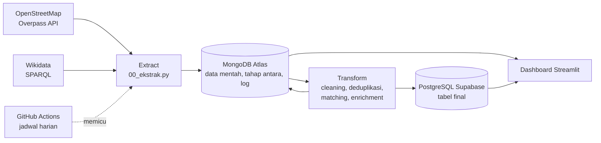
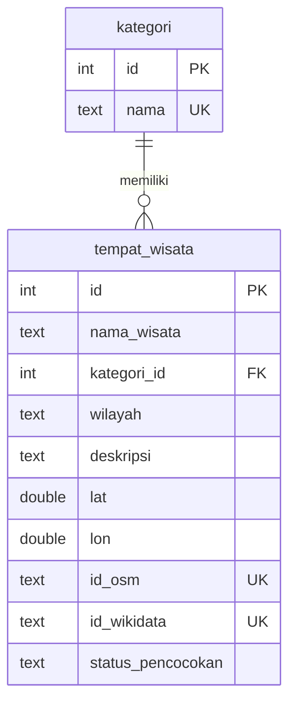

<div align="center">

# 🗺️ Pipeline Data Wisata Sumatera Utara

**Integrasi dan pembersihan data tempat wisata dengan arsitektur database hybrid**
**MongoDB + PostgreSQL · ETL otomatis · Dashboard Streamlit**

[](https://github.com/tiwyslbn/wisata-sumut-pipeline/actions/workflows/pipeline.yml)


### [🚀 Buka Dashboard](https://wisata-sumut-pipeline.streamlit.app/)

</div>

---

## ✨ Tentang Proyek

Data tempat wisata di Sumatera Utara tersebar di banyak sumber terbuka. Formatnya tidak seragam, banyak kolom kosong, dan satu tempat sering tercatat lebih dari sekali. Proyek ini membangun **data pipeline (ETL)** yang:

1. 📥 **Mengambil** data dari dua sumber terbuka: **OpenStreetMap** dan **Wikidata**
2. 🧹 **Membersihkan** dan menyeragamkan format, lalu membuang data yang tidak layak
3. 🔗 **Mencocokkan** tempat yang sama antar sumber, lalu **menggabungkan** informasinya
4. 💾 **Menyimpan** hasilnya ke dua jenis database yang berbeda
5. 📊 **Menampilkan** data dan kualitasnya di dashboard yang menyegarkan diri otomatis

> [!NOTE]
> Angka di dokumen ini berasal dari pengambilan data **12 November 2026**. Pipeline dijadwalkan mengambil data terbaru dari sumbernya, sehingga jumlah data di database dapat bergeser dari angka di sini.

## 🏗️ Arsitektur



### Mengapa dua jenis database?

| Database                       | Tugas                                                         | Alasan                                                                                                                                                   |
| ------------------------------ | ------------------------------------------------------------- | -------------------------------------------------------------------------------------------------------------------------------------------------------- |
| 🍃 **MongoDB** (dokumen)       | Data mentah, hasil tiap tahap, log pipeline, laporan kualitas | Kedua sumber punya kolom berbeda, dan banyak field berbentuk daftar (nama alternatif, kemungkinan duplikat). Model dokumen menyimpannya tanpa skema kaku |
| 🐘 **PostgreSQL** (relasional) | Tabel final tempat wisata                                     | Data akhir berstruktur tetap, butuh kunci asing dan batasan nilai, serta enak untuk kueri agregasi yang dipakai dashboard                                |

## 🔄 Alur Pipeline

| Langkah | Berkas                | Fungsi                                                                                                 |
| :-----: | --------------------- | ------------------------------------------------------------------------------------------------------ |
|    0    | `00_ekstrak.py`       | Mengambil data dari Overpass dan Wikidata, memeriksa hasilnya, lalu membandingkan dengan data lama     |
|    1    | `01_simpan_raw.py`    | Menyimpan data mentah apa adanya ke MongoDB                                                            |
|    2    | `02_profil_raw.py`    | Memeriksa kondisi data mentah (kosong, kembar, sebaran)                                                |
|    3    | `03_cleaning.py`      | Menyeragamkan format dan membuang data tidak layak (setiap pembuangan dicatat)                         |
|    4    | `04_deduplikasi.py`   | Menggabungkan data kembar di dalam satu sumber                                                         |
|    5    | `05_matching.py`      | Mencocokkan tempat yang sama antara dua sumber (kemiripan nama + jarak koordinat)                      |
|    6    | `06_enrichment.py`    | Menggabungkan informasi dua sumber menjadi satu data                                                   |
|    7    | `07_finalisasi.py`    | Membuang data bukan wisata, menentukan kategori, merapikan wilayah                                     |
|    8    | `08_gabung_manual.py` | Penggabungan hasil pemeriksaan manual di peta                                                          |
|    9    | `09_kualitas.py`      | Menghitung kelengkapan, konsistensi, dan hasil pencocokan                                              |
|   10    | `10_load_postgres.py` | Memuat data akhir ke PostgreSQL dalam satu transaksi                                                   |
|   ▶️    | **`pipeline.py`**     | Menjalankan semuanya berurutan, mencatat status tiap langkah, dan memeriksa konsistensi kedua database |

## 📈 Hasil

**Dari 2.061 data mentah menjadi 246 tempat wisata:**

| Tahap                                            | Berkurang |    Sisa |
| ------------------------------------------------ | --------: | ------: |
| Data mentah (324 OpenStreetMap + 1.737 Wikidata) |           |   2.061 |
| Cleaning                                         |     1.749 |     312 |
| Deduplikasi                                      |        35 |     277 |
| Penggabungan dua sumber                          |        17 |     260 |
| Finalisasi                                       |         9 |     251 |
| Penggabungan manual                              |         5 | **246** |

**Kualitas data akhir:**

| Aspek                     | Hasil                                                                               |
| ------------------------- | ----------------------------------------------------------------------------------- |
| Koordinat (`lat`, `lon`)  | 100% terisi                                                                         |
| Kategori                  | Wisata Alam 128 · Budaya & Sejarah 81 · Buatan & Edukasi 20 · Lainnya 13 · Religi 4 |
| Deskripsi                 | 36% terisi                                                                          |
| Wilayah                   | 20% terisi                                                                          |
| Jam operasional · Website | 6% · 2%                                                                             |
| Alamat · Harga tiket      | sekitar 0,4% (sumber tidak mencatatnya)                                             |
| Pencocokan dua sumber     | 18 pasangan diusulkan, 2 ditolak saat pemeriksaan manual, **16 digabung**           |

> [!IMPORTANT]
> Kelengkapan informasi tambahan rendah (sekitar 9,7% dari tujuh kolom). Penyebab utamanya sumber data, bukan program. Hasil pencocokan adalah **hasil pemeriksaan manual**, bukan akurasi terhadap data acuan yang lengkap.

## 📊 Dashboard

Dashboard membaca langsung dari **kedua database** dan menyegarkan diri tiap 30 detik.

| Tampilan          | Isi                                                                      | Sumber data            |
| ----------------- | ------------------------------------------------------------------------ | ---------------------- |
| **Ringkasan**     | Jumlah per kategori, asal data, wilayah terbanyak, alur jumlah data      | PostgreSQL dan MongoDB |
| **Peta dan Data** | Peta titik wisata, filter kategori dan asal data, pencarian nama         | PostgreSQL             |
| **Pipeline**      | Riwayat eksekusi, langkah dan lama tiap langkah, status pengambilan data | MongoDB                |
| **Kualitas Data** | Kelengkapan per kolom, konsistensi, hasil pencocokan                     | PostgreSQL dan MongoDB |

👉 **https://wisata-sumut-pipeline.streamlit.app/**

<!-- Setelah tangkapan layar disimpan di docs/img/, hapus tanda komentar di bawah ini.

### 📸 Tampilan

| Ringkasan | Peta dan Data |
|---|---|
|  |  |
| **Pipeline** | **Kualitas Data** |
|  |  |

-->

## 🗄️ Skema PostgreSQL



Skema lengkap ada di [`sql/skema_postgres.sql`](sql/skema_postgres.sql). Beberapa aturan yang dijaga database: kategori harus terdaftar (kunci asing), lintang dan bujur dibatasi rentangnya, status pencocokan hanya boleh `cocok`, `hanya_osm`, atau `hanya_wikidata`, dan ID OpenStreetMap serta Wikidata tidak boleh kembar.

## 🛠️ Teknologi

| Kebutuhan           | Teknologi                                          |
| ------------------- | -------------------------------------------------- |
| Bahasa              | Python 3.13                                        |
| Pengolahan data     | pandas                                             |
| Database dokumen    | MongoDB Atlas (PyMongo)                            |
| Database relasional | PostgreSQL di Supabase (psycopg2)                  |
| Pengambilan data    | Overpass API dan Wikidata Query Service (requests) |
| Dashboard           | Streamlit                                          |
| Otomatisasi         | GitHub Actions                                     |

## 🚀 Cara Menjalankan

**1. Salin proyek dan pasang library**

```powershell
git clone https://github.com/tiwyslbn/wisata-sumut-pipeline.git
cd wisata-sumut-pipeline
python -m venv venv
venv\Scripts\activate
pip install -r requirements.txt
```

**2. Buat berkas `.env`** di folder utama (berkas ini tidak ikut ke GitHub):

```
MONGODB_URI=mongodb+srv://<pengguna>:<kata-sandi>@<cluster>.mongodb.net/
POSTGRES_URI=postgresql://<pengguna>:<kata-sandi>@<host-pooler>:5432/postgres
```

> [!TIP]
> Untuk Supabase, pakai alamat **Session pooler** (menggunakan IPv4), bukan Direct connection.

**3. Jalankan**

| Perintah                          | Fungsi                                                                                     |
| --------------------------------- | ------------------------------------------------------------------------------------------ |
| `python pipeline.py`              | Menjalankan seluruh pipeline dengan data CSV yang sudah tersimpan (hasil sama setiap kali) |
| `python pipeline.py --ekstrak`    | Mengambil data terbaru dari sumber dulu, lalu menjalankan seluruh pipeline                 |
| `streamlit run dashboard/app.py`  | Menjalankan dashboard di `http://localhost:8501`                                           |
| `python backup.py --uji-pulihkan` | Membuat ZIP backup kedua database dan menguji pemulihannya                                 |

> [!WARNING]
> Pipeline **mengosongkan lalu mengisi ulang** koleksi MongoDB di database `wisata_sumut` dan tabel di skema `wisata_sumut` PostgreSQL. Pakai database khusus proyek ini.

## ⏰ Jadwal Otomatis

Workflow [`pipeline.yml`](.github/workflows/pipeline.yml) menjalankan `python pipeline.py --ekstrak` **setiap hari pukul 04:17 WIB** (21:17 UTC), dan bisa dijalankan manual lewat tab **Actions → Pipeline ETL → Run workflow**. Alamat koneksi disimpan sebagai _repository secrets_ `MONGODB_URI` dan `POSTGRES_URI`. Setiap eksekusi tercatat di koleksi `log_pipeline` dan tampil di dashboard.

## 💾 Backup dan Pemulihan

`backup.py` membuat satu berkas ZIP di folder `backup/`:

| Isi                                | Keterangan                                          |
| ---------------------------------- | --------------------------------------------------- |
| `mongodb/*.json`                   | Satu berkas JSON per koleksi                        |
| `postgresql/wisata_sumut_dump.sql` | Skema, tabel, dan seluruh data sebagai perintah SQL |
| `CARA_PULIHKAN.txt`                | Petunjuk memulihkan kedua database                  |

Dengan opsi `--uji-pulihkan`, dump SQL dipulihkan ke skema sementara lalu dibandingkan dengan data asli.

<details>
<summary><b>📁 Struktur folder</b></summary>

```
wisata-sumut-pipeline/
├── .github/workflows/pipeline.yml   # jadwal otomatis (GitHub Actions)
├── dashboard/app.py                 # dashboard Streamlit
├── sql/skema_postgres.sql           # skema tabel PostgreSQL
├── data/raw/                        # data mentah CSV (pengambilan 12 November 2026)
├── output/                          # CSV akhir dan laporan kualitas
├── koneksi.py                       # koneksi MongoDB dan pembaca alamat koneksi
├── pipeline.py                      # pipeline utama
├── 00_ekstrak.py ... 10_load_postgres.py
├── backup.py
├── requirements.txt
└── readme.md
```

Berkas `cek_*.py`, `lihat_*.py`, dan `tes*.py` adalah program bantu untuk memeriksa data dan koneksi (hanya membaca). `jalankan_semua.py` adalah versi awal pipeline sebelum ada PostgreSQL dan digantikan oleh `pipeline.py`.

</details>

<details>
<summary><b>⚖️ Keputusan desain dan keterbatasan</b></summary>

**Keputusan desain**

- Data mentah disimpan terpisah dan tidak pernah diubah, sehingga setiap tahap bisa diulang dan ditelusuri lewat koleksi `log_*`.
- Data yang dibuang selalu dicatat beserta alasannya, tidak dihapus diam-diam.
- Pasangan hasil pencocokan yang meragukan **tidak digabung**, supaya data akhir tidak memuat pencocokan yang tidak bisa dipertanggungjawabkan.
- Pemuatan ke PostgreSQL berjalan dalam satu transaksi: jika gagal, data lama tetap utuh.

**Keterbatasan**

- Proses berjalan **batch terjadwal**, bukan streaming murni. "Real-time" pada dashboard berarti membaca langsung dari database dan menyegarkan diri tiap 30 detik.
- Kelengkapan informasi rendah karena sumber tidak mencatat alamat, harga tiket, dan jam operasional untuk sebagian besar tempat.
- Kolom wilayah tidak seragam (campuran kabupaten, kota, dan kecamatan) dan hanya terisi sebagian.
- Sebagian kategori ditentukan dari kata kunci pada nama tempat, sehingga berupa perkiraan.
- Deduplikasi berbasis nama dapat melewatkan data kembar yang namanya berbeda.
- MongoDB dan PostgreSQL tidak diperbarui dalam satu transaksi: bila pemuatan ke PostgreSQL gagal, MongoDB sudah terisi data baru. Pipeline mencatatnya sebagai gagal, tetapi data tidak dipulihkan otomatis.
- Keputusan manual (pasangan yang digabung atau ditolak) didasarkan pada data per 12 November 2026 dan dapat perlu ditinjau ulang bila sumber berubah.
- Data OpenStreetMap dan Wikidata dibuat relawan, sehingga dapat memuat komentar pada kolom nama dan koordinat yang diragukan.

</details>

## 👥 Tim

**Kelompok 1** · D3 Teknik Informatika · Universitas Sumatera Utara
Mata kuliah **Manajemen Sistem Basis Data** · Dosen pengampu: Reza Taqyudin

| No  | Nama                   | NIM       |
| :-: | ---------------------- | --------- |
|  1  | Tiwy Lamberkat Silaban | 241712001 |
|  2  | Sultan Tri Ananda      | 241712003 |
|  3  | Dimas Surya Darma      | 241712018 |
|  4  | Adeptri Sagala         | 241712024 |
|  5  | Visela Simarmata       | 241712031 |

## 📜 Atribusi Data

Data tempat wisata bersumber dari **OpenStreetMap** © OpenStreetMap contributors (lisensi [ODbL](https://opendatacommons.org/licenses/odbl/)) dan **Wikidata** (lisensi [CC0](https://creativecommons.org/publicdomain/zero/1.0/)). Data diambil pada 12 November 2026.
